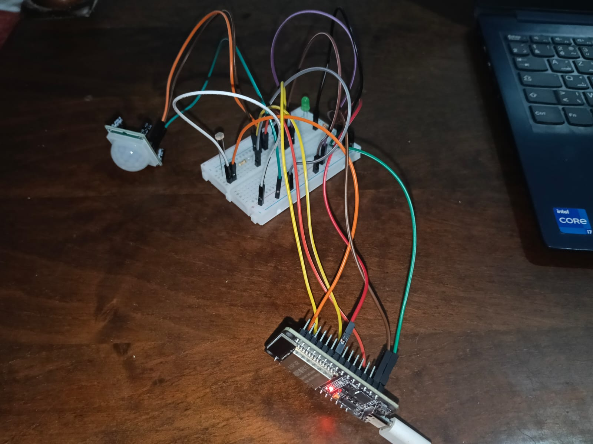

# Smart Streetlight (ESP32)

A prototype streetlight on an ESP32: it turns on when it gets dark, brightens when it detects motion, and can be controlled from the serial port.

> **Origin:** inspired by a mini-project from my Co-design module (ISITCom, Arduino Uno, push button as presence simulator). I rebuilt it on an ESP32 with a real PIR motion sensor. The code was written with AI assistance and tested on my own hardware.

- [Prototype in action](videos/prototype-demo.mp4)
- [Serial monitor output while running](videos/serial-monitor-demo.mp4)

## Behaviour

| Situation | Lamp |
|---|---|
| Bright (LDR above threshold) | Off |
| Dark | 20 % |
| Motion at night | 100 %, back to 20 % five seconds after the last detection |
| Command `MANU n` | n % (0-100) until `AUTO` |

- The potentiometer sets the day/night threshold.
- A moving average on the LDR and a hysteresis margin stop the lamp from flickering near the threshold.
- The PIR is ignored for the first 30 s after power-on (its warm-up time).
- One telemetry line per second, for example: `t=125 state=NIGHT ldr=205 thr=409 lamp=20 pir=0 count=12`

## Hardware

| Part | Pin |
|---|---|
| ESP32 DevKit | |
| LED + 100-220 Ω resistor (lamp) | GPIO 18 (PWM) |
| PIR HC-SR501 (VCC on VIN, 5 V) | GPIO 27 |
| LDR + 10 kΩ divider (LDR on 3V3 side) | GPIO 34 |
| Potentiometer 10 kΩ (threshold) | GPIO 35 |

The PIR's time-delay knob is set to its minimum so the 5 s timer is controlled by the code.

## Serial commands

115200 baud, line ending "Newline": `AUTO`, `MANU n` (n = 0..100, values above 100 are limited to 100), `?` (status).
Lines longer than 15 characters are rejected, not truncated.

## Design notes

- Non-blocking: no `delay()` anywhere. Tasks run on their own periods using `millis()`.
- State machine: DAY, NIGHT, MOTION, MANUAL. The lamp level depends only on the state.
- The ESP32 ADC is 12-bit (0-4095), so the hysteresis margin is scaled accordingly.

## Tested scenarios

| Scenario | Result |
|---|---|
| Bright room, motion | Lamp stays off, motions still counted |
| Cover the LDR | State NIGHT, lamp 20 % |
| Motion at night | Lamp 100 %, back to 20 % after ~5 s |
| LDR value near the threshold | No flicker |

## Possible next steps

- Replace the serial link with WiFi and MQTT
- Drive a real lamp through a MOSFET stage

## Tools

Arduino IDE, ESP32 board package 3.x

## Author

Mohamed Aziz Farhani, IoT Engineering Student at ISITCom Hammam Sousse
[LinkedIn](https://www.linkedin.com/in/mohamed-aziz-farhani-18540a33a)
